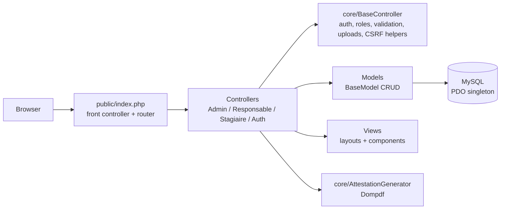

# Internship Management Platform — Urban Commune of Oujda


A web platform to manage the **internship lifecycle** at the Urban Commune of Oujda (Morocco): online applications with supporting documents, supervision by department supervisors, task follow-up, and generation of **bilingual (French / Arabic) internship certificates in PDF**.

The application is written in **plain PHP, without a framework**, using a custom **MVC architecture**: a front controller with a regex-based router, namespace-based class autoloading, a PDO singleton, base controller and base model classes, and role-based access control for three user spaces.

> **Project status:** the code base is being migrated from a page-based structure to MVC. The features listed under [Implemented](#implemented-mvc) are wired end to end; those under [In progress](#in-progress) exist in the code but are not fully connected yet. See [Known Issues](#known-issues).

---

## Table of Contents

- [Objectives](#objectives)
- [User Roles](#user-roles)
- [Features](#features)
- [Tech Stack](#tech-stack)
- [Architecture](#architecture)
- [Data Model](#data-model)
- [Project Structure](#project-structure)
- [Getting Started](#getting-started)
- [Screenshots](#screenshots)
- [Known Issues](#known-issues)
- [Future Work](#future-work)
- [Author](#author)

---

## Objectives

- Replace a paper-based internship process with an online workflow, from application to certificate.
- Give each actor (administration, supervisors, interns) a dedicated space with the right permissions.
- Generate official certificates automatically, with names in both French and Arabic.

## User Roles

| Role | Space | Responsibilities |
|---|---|---|
| **Administrator** | `/admin` | Reviews applications, manages supervisors and departments, assigns interns, generates start-of-internship certificates |
| **Supervisor** (*responsable*) | `/responsable` | Follows assigned interns, creates tasks, writes evaluations and remarks, generates end-of-internship certificates |
| **Intern** (*stagiaire*) | `/stagiaire` | Applies online, uploads documents, follows tasks and evaluations, downloads certificates |

## Features

### Implemented (MVC)

**Applications and authentication**
- Online **application form** with identity in French and Arabic, school, field of study, level and desired dates.
- Upload of **4 supporting documents** (CV, internship request, insurance, ID card scan), restricted to PDF / JPG / PNG and stored under unique file names.
- Automatically generated **intern number**; applications start with the *pending* status.
- Three separate login pages (administrator, supervisor, intern), with **bcrypt password hashing** (`password_hash` / `password_verify`) and automatic rehashing.
- Intern **"remember me"**: random 32-byte token valid for 30 days, stored in an `HttpOnly` cookie.
- Role checks in the base controller, with redirection to the right login page.

**Administrator**
- Dashboard: application counts by status, pending applications, latest registrations, statistics per department.
- Intern detail page.
- Generation and download of **start / end of internship certificates in PDF**, recorded in the database with a number in the `YEAR/0000/TYPE` format.

**Supervisor**
- Dashboard, intern detail page, task list and **task creation**, evaluations and reports pages.
- Generation and download of the **end-of-internship certificate**.

**Intern**
- Dashboard, profile, documents, tasks, evaluations.
- Viewing and downloading of certificates.

### In progress

Implemented in models, controllers or legacy scripts, but not fully wired yet:
- Accepting / rejecting applications (with a reason) and **CSV export**: implemented in `DashboardController`, while the routes point to `AdminController`.
- Admin pages for interns, supervisors and statistics; supervisor pages for the intern list and task creation form (views not created yet).
- Remarks management (create, edit, delete) in `controllers/responsable/ResponsableController.php`, not routed yet.
- AJAX actions in the dashboards (create a supervisor, add a department, assign an intern, validate documents, upload documents, submit the internship report, add a remark, record a decision), which still call the legacy endpoints.
- Automatic sending of certificates by e-mail (PHPMailer) in the legacy script `api/v1/admin/verifier_documents.php`.

## Tech Stack

| Layer | Technologies |
|---|---|
| Backend | PHP (no framework), custom MVC, PDO (prepared statements) |
| Database | MySQL (InnoDB), SQL migrations with a PHP migration runner |
| Frontend | PHP views, Bootstrap 5, Font Awesome, vanilla JavaScript (Fetch API) |
| Documents | Dompdf (certificate generation), mPDF and PhpWord `TemplateProcessor` (legacy generators) |
| E-mail | PHPMailer |
| Dependencies | Composer |

## Architecture



| Component | Role |
|---|---|
| `public/index.php` | Single entry point; maps clean URLs such as `admin/stagiaires/{id}` to `Controller::action` with named parameters |
| `core/Autoloader.php` | Namespace-based class autoloading |
| `core/Database.php` | PDO connection (singleton) |
| `core/BaseController.php` | Session user loading, `requireRole()`, JSON responses, input validation, file upload helper, pagination, CSRF token helpers |
| `core/BaseModel.php` / `models/` | Generic CRUD plus domain queries (search, statistics, assignment, validation) |
| `core/AttestationGenerator.php` | Fills HTML certificate templates (French and Arabic names, dates, department) and renders them to PDF |
| `utils/Security.php` | bcrypt hashing and rehash check, CSRF token generation and verification |

## Data Model

Main tables (`database/schema.sql`):

| Table | Content |
|---|---|
| `stagiaires` | Applicants and interns: bilingual identity, school, desired dates, status (`en_attente`, `valide`, `refuse`), assigned supervisor |
| `responsables`, `administrateurs` | Supervisor and administrator accounts |
| `services` | Municipal departments (IT, HR, Finance, Urban planning, Communication) |
| `stages`, `affectations` | Internships and assignment history |
| `documents`, `rapports` | Uploaded documents and internship reports, each with a validation status |
| `taches`, `remarques` | Tasks (priority, status) and supervisor remarks |
| `attestations` | Generated certificates (type, number, status, PDF path) |
| `notifications`, `stagiaires_passes` | Notifications and archived interns |

Schema changes (remember-me token, document paths, soft delete, foreign keys and indexes, InnoDB conversion) are versioned in `database/migrations/`.

## Project Structure

```
Gestion-des-stages/
├── public/              # Front controller, .htaccess, assets, uploads
├── config/              # App, database and e-mail configuration
├── core/                # Autoloader, Database, BaseController, BaseModel, AttestationGenerator
├── controllers/         # Controllers per role (+ auth controllers)
├── models/              # Stagiaire, Responsable, Admin, Tache, Remarque, Document
├── views/               # Views per role, layouts and reusable components (modals, certificate templates)
├── utils/               # Security, Validator, helpers, certificate generators
├── api/v1/              # Legacy JSON endpoints (being migrated)
├── database/            # Schema, migrations, migration runner, seed data
└── composer.json
```

## Getting Started

### Prerequisites

- PHP 8 with the `pdo_mysql`, `mbstring` and `dom` extensions (required by Dompdf)
- MySQL 5.7+ / 8
- Apache with `mod_rewrite` (e.g. WAMP / XAMPP)
- Composer

### Installation

```bash
git clone https://github.com/hind-bass/Gestion-des-stages.git
cd Gestion-des-stages
composer install
```

1. Create the database and tables, then apply the migrations:

   ```bash
   mysql -u root -p < database/schema.sql
   php database/migrate.php
   ```

2. Update the database credentials in `config/database.php` and `config/app.php`, and the base URL in `config/app.php` (default: `http://localhost/Projet4/public/`).
3. Point the web server to the `public/` folder, or place the project in the WAMP / XAMPP `www` directory.
4. Make `public/uploads/` writable by the web server.

The schema creates a default administrator account (`admin@commune.ma`); its initial password is documented in `database/schema.sql` and must be changed after the first login.

## Screenshots

<!-- TODO: add screenshots to docs/screenshots/ and reference them here, for example:


-->

## Known Issues

- The scripts in `api/v1/` include a `config.php` file that is not part of the repository, and the dashboards call them through older paths (for example `api/admin_stagiaires.php`).
- Some routes in `public/index.php` point to controller methods or views that do not exist yet (see [In progress](#in-progress)).
- The registration form does not send the `cin` field, which is `NOT NULL` in `database/schema.sql`.
- The migration runner skips several migrations that it assumes are already applied, so a fresh installation may need manual schema adjustments.

## Future Work

- Finish the MVC migration: route every action to a controller, create the missing views, and remove the legacy `api/v1` scripts.
- Enforce CSRF validation on all forms (helpers already exist in `BaseController` and `Utils\Security`).
- Send e-mail notifications on application decisions and certificate generation.
- Add charts to the statistics pages and automated tests (PHPUnit).
- Move configuration to environment variables and add a `.gitignore` (`vendor/`, `public/uploads/`).

## Author

**Hind Bassou** — Computer Engineering student, National School of Applied Sciences of Oujda (ENSAO)
GitHub: [@hind-bass](https://github.com/hind-bass)
